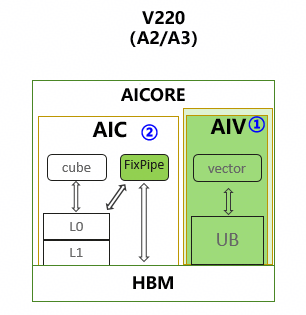

# Cube and Vector Optimization

**Applicable Products**:

<!-- npu="950" id1 -->
- Ascend 950PR/Ascend 950DT
<!-- end id1 -->
<!-- npu="A3" id2 -->
- Atlas A3 training products/Atlas A3 inference products
<!-- end id2 -->
<!-- npu="910b" id3 -->
- Atlas A2 training products/Atlas A2 inference products
<!-- end id3 -->

## Hardware Background

This document provides a macro-level overview of the overall Cube-Vector (CV) optimization process in AscendNPU IR. CV optimization targets the NPU hardware of Atlas A2 series products and Atlas A3 series products, focusing on the collaborative work of two core units, Cube (matrix multiplication unit) and Vector (vector operation unit). It performs a series of transformations at the HIVM (Huawei Intermediate Representation Virtual Machine) layer to improve the execution efficiency of mixed kernels (Mix Kernel).

### Terminology and Background Knowledge (Read Before Proceeding)

The following terms appear repeatedly throughout the CV documentation. It is recommended to establish a basic understanding of them before reading the details of each pass.

| Term | Meaning | Remarks |
|------|------|----------|
| **HIVM** | Hybrid Intelligence Virtual Machine | A dialect in AscendNPU IR that carries NPU-oriented operators (such as mmadL1, fixpipe, vadd) and control flow. |
| **IR** | Intermediate Representation | The abstract representation used by the compiler between source code and machine code. This repository uses MLIR (Multi-Level IR), and the IR is organized in SSA form. |
| **Bufferization** | The process of converting the tensor abstraction into concrete memory (memref) | In the "pre-bufferization" stage, the IR is still tensor-based (logical multi-dimensional arrays); after bufferization, memref (memory references with address/layout) is introduced. Most passes in CV run in the pre-bufferization stage, so expressions such as "tensor.empty" and "slice of tensor" are common in this document. |
| **tensor vs memref** | tensor: a logical multi-dimensional array with no explicit address; memref: a memory region with base address, strides, and shape | In the CV flow, the "output" of fixpipe is often first represented as a tensor, and later mapped to concrete memory through workspace (memref) or bufferization. |
| **Workspace** | A contiguous block of memory allocated on GM at runtime and passed in as a kernel argument | Used to store intermediate results between Cube and Vector (such as fixpipe output). Multiple intermediate buffers can be allocated on the same workspace by offset, with offsets computed by PlanMemory, thereby reusing one large buffer and reducing total occupancy. |
| **Liveness** | The lifetime of a buffer from "being defined/first used" to "last used" | PlanMemory determines whether two buffers may be alive simultaneously based on liveness; if they do not overlap, they can be assigned the same base address with different offsets to achieve reuse. |
| **Inplace** | The output of an operation is written directly onto the input's storage location, reusing the same buffer | For example, when vcast converts from f16 to i16 (equal width), the output can overwrite the input, reducing alloc. PlanMemory identifies ops that can be inplace and performs the corresponding offset allocation. |
| **AIC / AIV** | AIC: a sub-kernel primarily based on Cube; AIV: a sub-kernel primarily based on Vector | After the Mix kernel is split, AIC mainly executes on Cube cores and AIV mainly executes on Vector cores; the two pass data through fixpipe, DMA, etc., and their invocation order is coordinated by the Host or scheduler. |
| **Host / Device** | Host: runs on the CPU<br>Device: runs on the NPU | The Mix kernel belongs to the device side<br>In this document, "Mix can only be called by Host" means: in a kernel invocation initiated from the Host, a mix entry can be called, whereas another kernel on the device cannot directly call a mix function (current convention). |
| **CC / CV / VC / VV** | The two letters respectively denote the "preceding compute unit" and the "following compute unit": C=Cube, V=Vector | For example, CV means Cube finishes computation and then connects to Vector operations via fixpipe/load;<br>CC means two Cube stages are connected via fixpipe+load. Used to describe the matching mode of InsertWorkSpaceForMixCV. |

**About "pre-bufferization" and "post-bufferization"**:

Most CV-related passes run in the pre-bufferization phase (`hivmPreBufferizationOptimizationPipeline`), where the IR is still dominated by tensors and contains control flow such as `scf.for`. Bufferization converts tensors into memrefs and determines the physical layout; after that, there are optimizations in the post-bufferization phase (such as another round of PlanMemory targeting `memref.alloc`). Understanding "perform CV structural transformation first, then materialize memory" helps understand the pass order.

### Chip architecture

Ascend NPU adopts a heterogeneous computing architecture, which mainly includes:

| Component | Description | Typical Specifications (Example) |
|------|------|-------------------|
| **Cube** | Matrix multiplication unit, executing matrix operations such as `mmadL1` and `batchMmadL1` | 24 AI Cores |
| **Vector** | Vector operation unit, executing vector operations such as `vadd`, `vcast`, and `vreduce` | 48 AI Cores |
| **L0C** | Cube output buffer, storing matrix multiplication results | 128KB |
| **L0A/L0B** | Cube input buffers | 64KB |
| **UB** | Unified buffer, the main memory for Vector operations | 256 KB |
| **GM** | Global memory | External DDR |

fixpipe is the data transfer channel between Cube and Vector. The underlying Cube and Vector architectures of Ascend chips are separated. Different chip versions have different interaction paths. For example, for the 910 series, after Cube computation completes, the results are transferred from L0C to GM through fixpipe for subsequent Vector operations. In the IR, this is represented by the `hivm.hir.fixpipe` operator; at the hardware level, it corresponds to a dedicated L0C-to-UB data path that can simultaneously perform type conversion, quantization, and so on (controlled by attributes such as `pre_quant` and `pre_relu` of fixpipe). The chip architecture of the 910 series is as follows:


## Algorithm Principles

### createNormalizeMatmulPass

- **Function**: Normalizes the M/K/N dimensions, init conditions, and per-channel add forms of `hivm.hir.mmadL1` and `hivm.hir.batchMmadL1`.
- **Purpose**: Unifies the IR form of matmul to facilitate matching and transformation by subsequent passes such as fixpipe insertion and tiling.
- **Typical Transformations**: Inlines the bias in the vbrc + vadd form into the init of mmadL1; extracts the actual M/K/N and replaces constants; handles the PerChannel scenario.
- **Typical Scenarios**: `elementwise` accumulation.

Before transformation:

```mlir
%2 = ops // not 0 const
%3 = hivm.hir.mmadL1 ins(*)
       outs(%2 : tensor<16x32xf32>) -> tensor<16x32xf32>
```

After transformation:

```mlir
%2 = ops
%3 = tensor.empty() : tensor<16x32xf32>
%4 = hivm.hir.mmadL1 ins(*)
        outs(%3 : tensor<16x32xf32>) -> tensor<16x32xf32>
%5 = hivm.hir.vadd ins(%2, %4: tensor<16x32xf32>) outs(%2 : tensor<16x32xf32>)
```

### createInsertFixpipePass

- **Function**: Inserts `hivm.hir.fixpipe` between **mmadL1**/**batchMmadL1** and **store**, explicitly expressing the data movement from Cube to Vector.
- **Purpose**: Provides clear insertion points for subsequent workspace allocation and load/store insertion.
- **Typical Transformations**: Inserts **fixpipe** on the use chain from the **mmadL1** result to **store**.
- **Typical Scenarios**: When the Cube computation result needs to be moved from L0C through **fixpipe** before being stored (e.g., Cube output directly stored), **fixpipe** must be inserted to explicitly express the data path.

Before transformation:

```mlir
mmadL1 -> store
```

After transformation:

```mlir
mmadL1 -> fixpipe
```

### createInlineFixpipePass

- **Function**: Based on the fixpipe inserted by `InsertFixpipe`, inline ops such as `vcast`, `vrelu`, and `store` into the quantization and activation options of fixpipe.
- **Purpose**: Leverage the `pre_quant`, `pre_relu`, and other capabilities of the fixpipe hardware to reduce independent vector instructions.
- **Typical transformations**: Fuse operators such as `vcast` (converting `f32` to `f16`) into the fixpipe's `pre_quant = F322F16`.
- **Typical scenarios**: When fusable operators such as vcast, vrelu, and store exist downstream of fixpipe, they need to be inlined into the quantization and activation options of fixpipe to reduce independent vector instructions.

Before transformation:

```mlir
mmadL1 -> fixpipe -> vcast
```

After transformation:

```mlir
mmadL1 -> fixpipe{pre_quant = F322F16}
```

### createTileBatchMMIntoLoopPass

- **Function**: Expands `hivm.hir.batchMmadL1` along the batch dimension into an `scf.for` loop, where each iteration executes a single `mmadL1` and fixpipe.
- **Purpose**: Splits the batch dimension into a loop so that load/fixpipe/store can be accessed by batch index, facilitating workspace management and pipelining.
- **Typical Transformation**: TileBatchMMIntoLoop expands batchMmadL1 into a loop.

Before transformation:

```mlir
batchmmadL1 a : [batch, m, k], b[batch, k, n]
fixpipe workspace : [batch, m, n]
```

After transformation:

```mlir
for batch_idx in range(batch):
  mmadL1(extract_slice(a), extract_slice(b))
  fixpipe(extract_slice(workspace))
```

### createInsertLoadStoreForMixCVPass

- **Function**: Inserts `load`/`store` at the Cube-Vector junction so that data flows correctly between tensors and the global workspace.
- **Purpose**: Ensures correct data transfer between CV operations.
- **Typical Transformation**: batchMmadL1 + fixpipe is rewritten as mmadL1 + fixpipe inside a loop, with extract_slice / insert_slice applied to the inputs/outputs.
- **Typical Scenario**: Cube-Vector mixed (CV mode).

Before transformation:

```mlir
mmadL1
fixpipe
vadd
```

After transformation:

```mlir
mmadL1
fixpipe
load
vadd
```

### createInsertWorkSpaceForMixCVPass

- **Function**: Replaces `tensor.empty` with `memref_ext.alloc_workspace` at Cube-Vector intersection points (CC/CV/VC/VV).
- **Purpose**: Changes intermediate buffers such as fixpipe outputs and store outputs to be allocated from the global workspace, enabling sharing across iterations and cores.
- **Matching Modes**: CC (`mmadL1`→`fixpipe`→`load`→`mmadL1`), CV (`mmadL1`→`fixpipe`→`load`→`vector`), VC (`vector`→`store`→`load`→`mmadL1`), VV (`vector`→`store`→`load`→`vector`).
- **Typical Scenario**: Cube-Vector mixed (CV mode).

Before transformation:

```mlir
%1 = mmadL1
%2 = tensor.empty() 
%3 = fixpipe ins(%1) outs(%2)
%4 = load ins(%3)
vadd (%4)
```

After transformation:

```mlir
%1 = mmadL1
%2 = memref_ext.alloc_workspace()
%3 =  bufferization.to_tensor(%2)
%4 = fixpipe ins(%1) outs(%3)
%5 = load ins(%4)
vadd (%5)
```

### createBindWorkSpaceArgPass

- **Function**: Binds `memref_ext.alloc_workspace` within the function to the function's workspace parameter (`hacc.arg_type = #hacc.arg_type<workspace>`).
- **Purpose**: Unifies the workspace source so that the runtime passes in the workspace pointer through the parameter, enabling multiple kernels to share a single workspace.
- **Prerequisites**: The function must have a workspace parameter; `InsertWorkSpaceForMixCV` has already inserted `alloc_workspace`.
- **Typical Scenario**: Cube-Vector mixed (CV mode).

Before transformation:

```mlir
func.func @bind_workspace_arg(
              %arg0: i64 {hacc.arg_type = #hacc.arg_type<ffts_base_address>},
              %arg1: memref<?xi8> {hacc.arg_type = #hacc.arg_type<workspace>}){
  memref_ext.alloc_workspace() : memref<100xi32>
  return
}
```

After transformation:

```mlir
func.func @bind_workspace_arg(
              %arg0: i64 {hacc.arg_type = #hacc.arg_type<ffts_base_address>},
              %arg1: memref<?xi8> {hacc.arg_type = #hacc.arg_type<workspace>}){
  memref_ext.alloc_workspace() from %arg1 : memref<100xi32>
  return
}
```

### createPlanMemoryPass

- **Function**: In `GLOBAL_WORKSPACE_PLAN` mode, performs memory planning for `memref_ext.alloc_workspace`, replacing the alloc with `hivm.hir.pointer_cast` + offset.
- **Purpose**: On a given workspace base address, allocates offsets according to liveness and inplace rules to maximize reuse and reduce the total workspace size.
- **Typical Transformation**: Multiple alloc_workspace operations are mapped to different offsets of the same workspace; conflicting buffers are allocated different offsets.

Before transformation:

```mlir
func.func @bind_workspace_arg(
              %arg0: i64 {hacc.arg_type = #hacc.arg_type<ffts_base_address>},
              %arg1: memref<?xi8> {hacc.arg_type = #hacc.arg_type<workspace>}){
  memref_ext.alloc_workspace() from %arg1 : memref<100xi32>
  return
}
```

After transformation:

```mlir
func.func @bind_workspace_arg(
              %arg0: i64 {hacc.arg_type = #hacc.arg_type<ffts_base_address>},
              %arg1: memref<?xi8> {hacc.arg_type = #hacc.arg_type<workspace>}){
  memref_ext.alloc_workspace() from %arg1 offset=[0] : memref<100xi32>
  return
}
```

### createSplitMixKernelPass

- **Function**: Splits a mixed kernel into two sub-functions, AIC (Cube-primary) and AIV (Vector-primary), and generates a mix entry.
- **Purpose**: The backend can schedule AIC and AIV to the Cube and Vector cores respectively, facilitating pipelining and synchronization.
- **Typical Transformation**: Traverses the IR according to the core type, placing Cube-related code into AIC and Vector-related code into AIV; uses `annotation.mark` to mark tensors passed across cores.

Before transformation:

```mlir
func.func @bind_workspace_arg(
              %arg0: i64 {hacc.arg_type = #hacc.arg_type<ffts_base_address>},
              %arg1: memref<?xi8> {hacc.arg_type = #hacc.arg_type<workspace>},
     hivm.func_core_type = #hivm.func_core_type<MIX>){
  mmadl1
  memref_ext.alloc_workspace() from %arg1 offset=[0] : memref<100xi32>
  fixpipe
  load
  vadd
}
```

After transformation:

```mlir
func.func @bind_workspace_arg_aic(
              %arg0: i64 {hacc.arg_type = #hacc.arg_type<ffts_base_address>},
              %arg1: memref<?xi8> {hacc.arg_type = #hacc.arg_type<workspace>},
     hivm.func_core_type = #hivm.func_core_type<AIC>){
  mmadl1
  memref_ext.alloc_workspace() from %arg1 offset=[0] : memref<100xi32>
  fixpipe
}
func.func @bind_workspace_arg_aiv(
              %arg0: i64 {hacc.arg_type = #hacc.arg_type<ffts_base_address>},
              %arg1: memref<?xi8> {hacc.arg_type = #hacc.arg_type<workspace>},
     hivm.func_core_type = #hivm.func_core_type<AIV>){
  load
  vadd
}
```

## Local Debugging and Testing Methods

**Single Pass Debugging Command**:

```bash
bishengir-opt -hivm-normalize-matmul input.mlir -o output.mlir
bishengir-opt -hivm-inline-fixpipe input.mlir -o output.mlir
bishengir-opt --hivm-tile-batchmm-into-loop input.mlir -o output.mlir
bishengir-opt -insert-workspace-for-mix-cv input.mlir -o output.mlir
bishengir-opt --hivm-bind-workspace-arg input.mlir -o output.mlir
bishengir-opt -hivm-plan-memory -mem-plan-mode=global-work-space-plan input.mlir -o output.mlir
# Run the standalone split-mixed-if explicitly when needed; TCB mark/hoist is only for Ascend950.
bishengir-opt -hivm-split-mixed-if-conditionals -hivm-mark-tightly-coupled-buffer \
  -hivm-hoist-tightly-coupled-alloc -hivm-split-mix-kernel input.mlir -o output.mlir
```

**Test Case Storage Path**:

Currently, all test cases in the library are located under `path-to-ascendnpuir/bishengir/test`. To run a specific pass, search for the corresponding compilation command to find the relevant test file. For example, searching for `hivm-normalize-matmul` will locate the corresponding test file `bishengir/test/Dialect/HIVM/normalize-matmul.mlir`.

**Test Execution Method**:

The specific run command is provided at the top of each test file. For example:

```bash
// RUN: bishengir-opt -hivm-normalize-matmul %s -split-input-file -verify-diagnostics -allow-unregistered-dialect | FileCheck %s
```

Here, `bishengir-opt` and `FileCheck` are both compiled binary executables located under `path-to-ascendnpuir/build/bin`. In the command above, replace `%s` with the corresponding test file `bishengir/test/Dialect/HIVM/normalize-matmul.mlir`.

The output `mlir` is matched against the `CHECK:` sections in the test file. The test succeeds if no `CHECK failed` errors are reported.

## Constraints and Capabilities

- `createPlanMemoryPass` handles the space size at data interaction points. Because it dynamically returns the total space size required by the data, there is no limit on the size.
- `createInlineFixpipePass` can currently inline only three types of ops: `vcast`, `relu`, and `store`.
